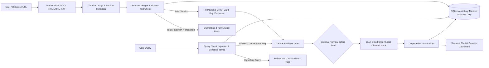

# TrustGate

**A security-first Retrieval-Augmented Generation (RAG) shield that detects indirect prompt injections, hidden text, and PII leaks before documents reach your LLM.**

---

## Problem

Standard RAG pipelines ingest PDFs, DOCX files, web pages, and text documents and pass retrieved chunks straight into an LLM prompt. Attackers can hide instructions inside white-on-white PDF text, microscopic fonts, DOCX hidden runs/comments, `display:none` HTML blocks, or zero-width Unicode characters—hijacking model behavior (such as CV ranking manipulation or data exfiltration) or leaking sensitive PII like CNICs, cards, and API keys.

---

## Architecture



---

## Key Features & Supported Formats

- **Prompt-Injection & Hidden-Text Scanner** (`shield/scanner.py`): 28 case-insensitive injection patterns paired with structural hidden-text extraction.
- **Supported Formats**: `.pdf` (`PyMuPDF`), `.docx` (`python-docx` + XML), `.html`/`.htm` & live URLs (`BeautifulSoup4`), and `.txt`/`.md`.
- **Quarantine & Response Policies** (`shield/engine.py`): Quarantined chunks never enter the index or reach the LLM. Default **Sanitize** drops bad chunks; **Strict Block** rejects the whole document if `> 30%` of chunks are suspicious.
- **PII Redaction & Query Guard** (`shield/pii.py`): Masks high-risk secrets before chunks reach the LLM and masks all PII in LLM responses; refuses queries asking for CNIC/card/password/API keys.
- **Preview Before Send**: Optional Chat checkbox to inspect the exact redacted context + question and confirm before calling the LLM.
- **Shield ON/OFF Toggle**: Live comparison between unprotected RAG (triggers governance warning) and protected RAG.
- **Security Dashboard & SQLite Audit Log** (`dashboard.py`, `shield/audit_log.py`): Metrics, Blocked vs Allowed, Findings by Type, OWASP/NIST control charts, format breakdown, and masked-snippet-only audit table.

---

## Quick Start

```powershell
# 1. Create and activate virtual environment
python -m venv .venv
.\.venv\Scripts\Activate.ps1

# 2. Install dependencies
pip install -r requirements.txt

# 3. Configure environment (optional for Cloud Groq mode)
Copy-Item .env.example .env
# Add your GROQ_API_KEY inside .env (never commit .env)

# 4. Generate sample, demo, and evaluation files
python scripts/generate_samples.py
python scripts/generate_demo_files.py
python scripts/generate_test_suite.py

# 5. Run tests & evaluation
python scripts/smoke_test.py
python scripts/run_day2_scan.py
python evaluate.py

# 6. Launch Streamlit UI
streamlit run app.py
```

---

## LLM Modes & `.env` Setup

| Mode | Backend | Default Model | Notes |
| :--- | :--- | :--- | :--- |
| **Cloud (Groq)** | `GroqLLM` | `openai/gpt-oss-20b` | Requires `GROQ_API_KEY` in `.env`. Displays UI notice: *"Text is sent to an external API after redaction. Do not upload highly confidential documents."* |
| **Local (Ollama)** | `OllamaLLM` | `llama3.2:3b` | Connects to `OLLAMA_BASE_URL` (`http://localhost:11434`). If Ollama is not running, shows a visible warning banner and falls back to `MockLLM`. |
| **Mock (Offline)** | `MockLLM` | Offline deterministic | Zero network or API key required; returns grounded context snippets for testing and demos. |

---

## Governance & Security Policies

### Framework Mapping (`shield/control_map.py`)

| Feature / Finding | OWASP LLM Top 10 | NIST CSF 2.0 | NIST AI RMF |
| :--- | :--- | :--- | :--- |
| `prompt_injection` | `LLM01:2025` Prompt Injection | `DE.CM-09`, `PR.DS-02` | `MAP 1.5`, `MEASURE 2.7` |
| `hidden_text` | `LLM01:2025` Indirect Prompt Injection | `DE.AE-02`, `PR.DS-01` | `MEASURE 2.6`, `GOVERN 1.2` |
| `pii_leak` / `pii_high_risk` | `LLM02:2025` Sensitive Info Disclosure | `PR.DS-01`, `PR.DS-10` | `MANAGE 2.2`, `MEASURE 2.11` |
| `secret_exposed` | `LLM02:2025` Sensitive Info Disclosure | `PR.DS-01`, `PR.AA-05` | `MANAGE 2.2`, `GOVERN 1.4` |
| `sensitive_query` | `LLM02:2025` Sensitive Info Disclosure | `PR.AA-05`, `DE.CM-01` | `GOVERN 1.4`, `MANAGE 4.1` |
| `strict_block` | `LLM01:2025` & `LLM08:2025` Vector Weakness | `RS.MI-01`, `PR.DS-02` | `MANAGE 1.3`, `MANAGE 2.4` |

### Response Policy
- **Sanitize (Default)**: Suspicious/injected chunks (`action="quarantine"`) are excluded from the index and LLM prompt; remaining clean chunks are kept and answered from.
- **Strict Block (`> 30%` Suspicious)**: If more than `30%` of a document's chunks trigger quarantine or hidden-text alerts, the entire document is rejected (`0` chunks indexed).

### PII Policy & Query-Side Check

| PII Category | Chunk Handling (Before LLM) | LLM Output Handling | Query-Side Check |
| :--- | :--- | :--- | :--- |
| **CNIC** (`\d{5}-\d{7}-\d`) | Always masked (`[MASKED_CNIC]`) | Always masked | **Refused** with OWASP/NIST tags |
| **Card Numbers** | Always masked (`[MASKED_CARD]`) | Always masked | **Refused** with OWASP/NIST tags |
| **Passwords / API Keys** | Always masked (`[MASKED_PASSWORD]` / `[MASKED_API_KEY]`) | Always masked | **Refused** with OWASP/NIST tags |
| **Email & Phone** | Flagged only (document stays searchable) | Masked (`[MASKED_EMAIL]` / `[MASKED_PHONE]`) | **Warned** with framework tags; answer masked |

---

## Evaluation (from `results/results.md`)

All numbers below are taken directly from [`results/results.md`](results/results.md), generated by running `evaluate.py` against the deterministic 26-file synthetic suite (`tests/labels.csv`):

### Overall Summary (`results/results.md`)
- **Total Test Files**: `26` (`6` clean including `2` CVs with normal fake email & phone, `20` distinct attacks)
- **Clean Files / False Positives**: `6 / 0` (**0.0% FP**)
- **Attack Files / Blocked**: `20 / 17` (**85.0% Detection**)
- **Missed Attacks**: `3`

### Per-Format Detection Rate (`results/results.md`)
| Format | Attacks | Blocked | Detection Rate | Clean | False Positives |
| :--- | :--- | :--- | :--- | :--- | :--- |
| `DOCX` | 5 | 5 | 100.0% | 2 | 0 |
| `HTML` | 3 | 3 | 100.0% | 0 | 0 |
| `PDF` | 6 | 4 | 66.7% | 2 | 0 |
| `TXT` | 6 | 5 | 83.3% | 2 | 0 |

### Ablation Study (`results/results.md`)
| Configuration | Doc Detection Rate | Doc FP Rate | Full Suite (Docs + PII/Query) | Full Suite FP |
| :--- | :--- | :--- | :--- | :--- |
| A: Regex patterns only | 13/20 (65.0%) | 0/6 (0.0%) | 13/30 (43.3%) | 0/10 (0.0%) |
| B: Regex + Hidden-text detection | 17/20 (85.0%) | 0/6 (0.0%) | 17/30 (56.7%) | 0/10 (0.0%) |
| C: Regex + Hidden-text + PII/Query checks | 17/20 (85.0%) | 0/6 (0.0%) | 27/30 (90.0%) | 0/10 (0.0%) |

### PII Detection Benchmark (`results/results.md`)
| PII Type | Samples | Detected | Masked | Rate |
| :--- | :--- | :--- | :--- | :--- |
| `CNIC` | 5 | 5 | 5 | 100.0% |
| `PHONE` | 5 | 5 | 5 | 100.0% |
| `EMAIL` | 5 | 5 | 5 | 100.0% |
| `CARD` | 5 | 5 | 5 | 100.0% |
| `API_KEY` | 5 | 5 | 5 | 100.0% |
| `NEGATIVE_CLEAN` | 5 | 0 | 0 | 0.0% FP |

### Missed Attacks (`results/results.md`)
1. `attack_03_off_page.pdf` (`PDF`, `off_page_pdf`) — `PyMuPDF` `get_text("dict")` clips spans outside `page.rect` by default.
2. `attack_04_pdf_metadata_annot.pdf` (`PDF`, `pdf_annotation_metadata`) — PDF metadata fields and PDF annotations are not currently inspected.
3. `attack_20_split_words.txt` (`TXT`, `obfuscated_split_words`) — Character-spaced obfuscation (`I g n o r e ...`) evades word-level regexes.

---

## Limitations & Future Work

**Limitations**
- Regex-based injection rules miss novel paraphrased phrasing and character-split/heavy obfuscation.
- No OCR pipeline for image-only PDFs or screenshots containing embedded prompt text.
- PDF metadata fields, PDF annotations, and `PyMuPDF` clipped off-page coordinates are not currently scanned.
- PII redaction reduces exposure in Cloud mode, but does not eliminate third-party data transfer risk—use **Local (Ollama)** for confidential files.
- TrustGate is **compliance-aligned** with OWASP LLM Top 10, NIST CSF 2.0, and NIST AI RMF—not formally certified.

**Future Work**
- Inspect PDF annotations (`page.annots()`), PDF metadata (`doc.metadata`), and unclipped `PyMuPDF` text rectangles (`clip=pymupdf.INFINITE_RECT()`).
- Add whitespace/de-obfuscation normalization and an optional local classifier (e.g., Prompt Guard) alongside regexes.
- Add OCR support (`pytesseract`) for scanned/image-only PDFs and dense vector embeddings (FAISS/Chroma) alongside TF-IDF.

---

## Project Structure

```text
TrustGate/
├── app.py                     # Streamlit UI (Chat & Documents + Security Dashboard tabs)
├── dashboard.py               # SQLite-backed Security Dashboard & Test Results renderer
├── config.py                  # Settings loader (.env) for Groq, Ollama, and RAG defaults
├── evaluate.py                # 26-file evaluation, real A/B/C ablation & PII benchmark
├── .env.example               # Environment template (copy to .env)
├── requirements.txt
├── rag/
│   ├── loader.py              # PDF, DOCX, HTML/URL, and TXT/MD extraction
│   ├── chunker.py             # Sliding-window chunker preserving page/section metadata
│   ├── retriever.py           # In-memory TF-IDF cosine retriever
│   ├── llm.py                 # MockLLM, GroqLLM, and OllamaLLM (llama3.2:3b)
│   └── pipeline.py            # RAGPipeline with prepare_ask / complete_ask / ask
├── shield/
│   ├── scanner.py             # Prompt-injection regexes & hidden-text detectors
│   ├── pii.py                 # Regex PII detection & masking (CNIC, card, key, pwd, email, phone)
│   ├── control_map.py         # OWASP LLM Top 10 / NIST AI RMF / NIST CSF mappings
│   ├── audit_log.py           # SQLite logger storing masked snippets only
│   └── engine.py              # TrustGateShield (quarantine, sanitize/>30% strict block, query check)
├── demo/                      # Fake-data demo files + 3-minute DEMO_SCRIPT.md
├── scripts/                   # Generators and smoke/scan verification scripts
├── tests/                     # Deterministic 26-file evaluation suite + labels.csv
└── results/                   # results.csv and results.md
```

---

## How to Add a New Loader

1. Add the new file extension (e.g., `.csv` or `.rtf`) to `SUPPORTED_EXTENSIONS` in `rag/loader.py`.
2. Write an extractor function returning `(full_text, metadata, segments)` where each segment is a dict `{"text": ..., "location": ..., "hidden_findings": [...], "hidden_texts": [...]}` (see `extract_html_with_hidden` in `shield/scanner.py`).
3. Hook the extension branch into `load_uploaded_file()` in `rag/loader.py`—`chunk_document()` and `TrustGateShield` will automatically scan segments, preserve locations, mask PII, and log findings to SQLite.
